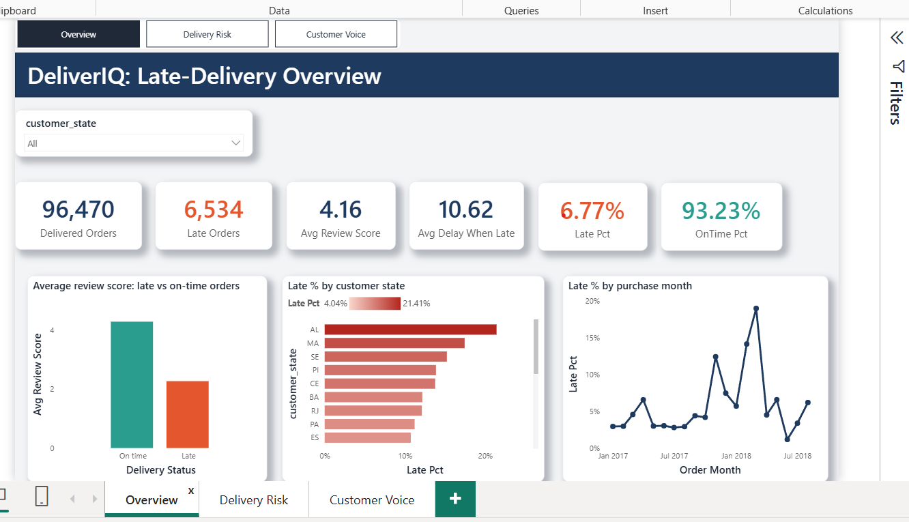
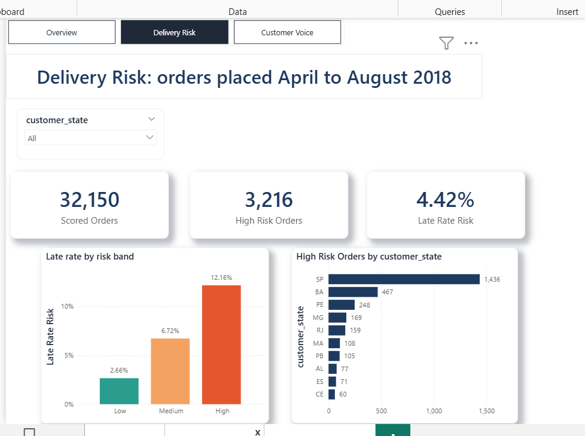
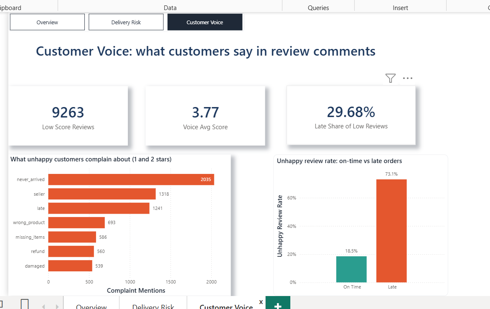

# DeliverIQ: Late-Delivery Risk and Customer Experience Intelligence

A portfolio project built on the public Olist Brazilian e-commerce dataset. It answers three questions:

1. How often are orders delivered late, and where?

2. Can we flag risky orders at purchase time, before they go wrong?

3. What do unhappy customers say, and how much of it is about delivery?

**Tools:** MySQL, SQL, Python (pandas, SQLAlchemy, scikit-learn), Jupyter, Power BI, Git and GitHub.

## Dashboard

**Overview: how late are we, and where?**

**Delivery Risk: which orders should we watch?** (orders placed April to August 2018, never seen by the model in training)

**Customer Voice: what do unhappy customers say?**

## Key findings

| Finding | Number |

| --- | --- |

| Delivered orders analysed | 96,470 |

| Late orders (delivered at least one calendar day after the estimated date) | 6.77% (6,534 orders) |

| Average review score, on-time vs late orders | 4.29 vs 2.27 |

| Share of 1-star reviews, on-time vs late orders | 6.5% vs 52.4% |

| Unhappy review rate (1 or 2 stars, reviews with a comment), on-time vs late | 18.5% vs 73.1%, about 4 times higher |

| Late share among all unhappy reviews with a comment | 29.68%, so most unhappy reviews have other causes |

| Most common complaint themes (1 and 2 stars) | never arrived (2,035), seller (1,318), late (1,241) |

### Risk model

The model ranks orders by late risk using only facts known at purchase time (month, weekday, promised days, states, items, sellers, value, freight, weight, category, distance between seller and customer, seller shipping deadline).

- Delivery date, delay and review score are excluded on purpose, because they are not known at purchase time (data leakage).

- A random train/test split gave a flattering ROC-AUC of 0.778. A time-based split (train on orders before 2018-04-01, test on orders after) is the honest estimate: **ROC-AUC about 0.71** after adding distance and shipping-deadline features.

- Risk bands on the 32,150 test orders:

| Risk band | Orders | Actual late rate |

| --- | --- | --- |

| High (riskiest 10%) | 3,216 | 12.2% |

| Medium (next 20%) | 6,429 | 6.7% |

| Low (remaining 70%) | 22,505 | 2.7% |

High-band orders are about 4.5 times as likely to be late as Low-band orders. The test period has a lower overall late rate (4.4%) than the full data (6.77%), so the Delivery Risk page is labelled with its date range.

## Project structure

| File | Purpose |

| --- | --- |

| `load_olist_to_mysql.py` | Loads every Olist CSV into MySQL tables (password typed at run time, never stored) |

| `DeliverIQ_Queries.sql` | Health checks, indexes, data-quality checks, views and KPI queries |

| `DeliverIQ_model.ipynb` | Analysis, features, models, risk bands and review themes |

| `DeliverIQ_theme.json` | Power BI colour theme |

| `dashboard_*.png` | Dashboard screenshots |

| Ask-your-data assistant | Cells at the end of `DeliverIQ_model.ipynb`: answers 15 question types from SQL, and a 22-question test |

The data files (`*.csv`) and the Power BI file are not stored in this repository.

## How to run it

1. Download the Olist Brazilian E-Commerce dataset from Kaggle and put the CSV files in a folder called `Data`.

2. Create an empty MySQL database called `deliveriq`.

3. Install the packages: `pip install pandas sqlalchemy pymysql scikit-learn matplotlib notebook`.

4. Run `python load_olist_to_mysql.py` and enter your MySQL password when asked.

5. Run `DeliverIQ_Queries.sql` in MySQL to create the indexes and views.

6. Open `DeliverIQ_model.ipynb` in Jupyter and run the cells from top to bottom.

## Limitations

- The model is modest (ROC-AUC about 0.71). It is useful for ranking risk, not for predicting single orders with certainty.

- The risk scores cover April to August 2018 only, because they come from the time-based test period.

- Complaint themes come from Portuguese keyword rules, so they are approximate and not checked against hand-labelled comments. "Never arrived" overlaps with delivery problems.

- Only reviews with a written comment are used for the Customer Voice page, and people who write comments tend to be less happy.

- The "ask your data" assistant is rule-based: it answers only the question types prepared for it, and replies that it cannot answer anything else. It uses no language model, so every number it prints comes from the database.

